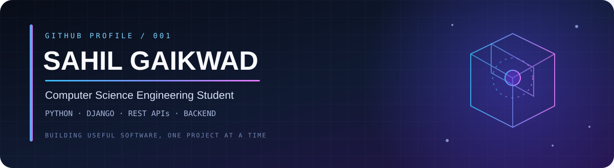
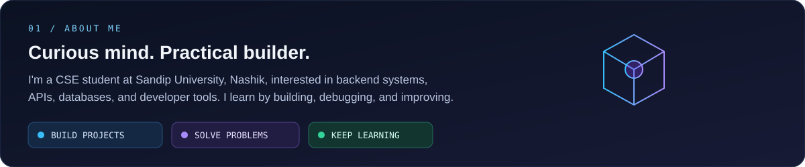
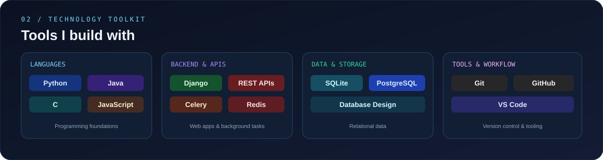
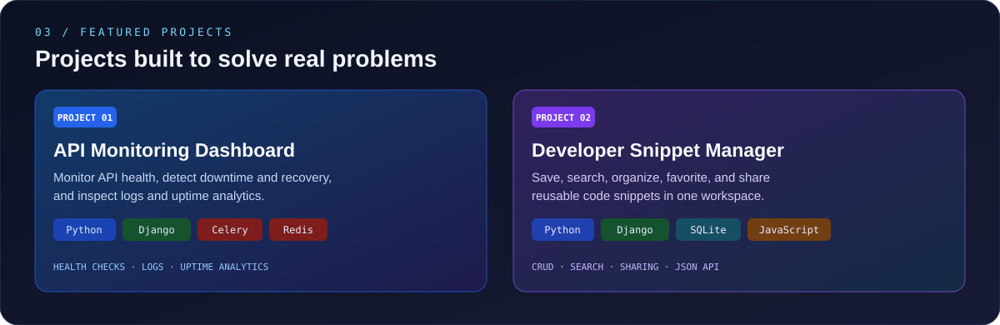
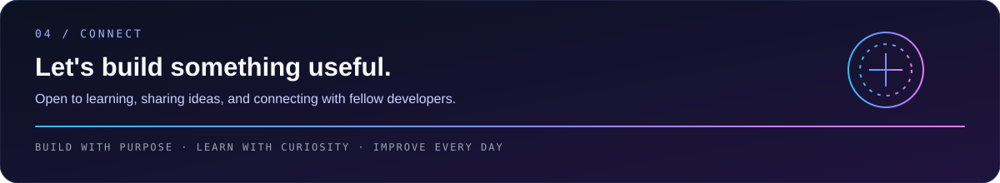

<!--
  GitHub Profile README — Sahil Gaikwad
  Profile repository: itz-sahilgaikwad/itz-sahilgaikwad
-->

  
  

---

## 👋 About Me

I'm a **Computer Science Engineering student at Sandip University, Nashik**. I enjoy learning by building practical applications, solving programming problems, and improving my development skills through real projects.

- **Current focus:** Python, Django, REST APIs, and databases
- **Development interests:** Backend engineering and full-stack development
- **Practising:** Object-Oriented Programming, Data Structures and Algorithms, and SQL
- **Approach:** Build projects, understand the underlying concepts, and improve through debugging

---

## 🧭 Quick Navigation

[About Me](#-about-me) ·
[Technology](#-technology-toolkit) ·
[Projects](#-featured-projects) ·
[GitHub Activity](#-github-activity) ·
[Learning](#-currently-learning) ·
[Connect](#-connect)

---

## 🛠️ Technology Toolkit

  
<strong>Explore my technologies</strong>

  **Programming Languages**
  - Python
  - Java
  - C
  - JavaScript

  **Backend and APIs**
  - Django
  - Django REST Framework
  - Flask
  - Celery
  - Redis

  **Frontend**
  - HTML
  - CSS
  - JavaScript
  - React
  - Tailwind CSS
  - Vite

  **Databases**
  - SQLite
  - PostgreSQL
  - SQL

  **Tools**
  - Git
  - GitHub
  - VS Code
  - Docker

  *This list includes technologies used in projects or explored while learning. It does not imply expert-level proficiency in every technology.*

---

## 🚀 Featured Projects

### 📡 API Monitoring Dashboard

A backend-focused application that monitors API health, records check results, and detects service downtime and recovery.

**Key features**
- API health checks and monitoring logs
- Downtime and recovery detection
- Uptime percentage analytics
- Background monitoring with Celery and Redis
- Email alerts for monitoring events
- PostgreSQL support for deployment

**Technology stack**

`Python` `Django` `Django REST Framework` `Celery` `Redis` `PostgreSQL`

  

### 🗂️ Developer Snippet Manager

A Django application for storing, organizing, searching, and sharing reusable code snippets.

**Key features**
- Create, edit, and delete snippets
- Search, filtering, and pagination
- Favorites and public sharing links
- User authentication with email OTP verification
- JSON API
- Syntax-highlighted code display

**Technology stack**

`Python` `Django` `SQLite` `HTML` `CSS` `JavaScript`

> **Repository:** The public repository link can be added here when available.

---

## 📊 GitHub Activity

<table>
  <tr>
    <td width="50%" align="center" valign="top">
      
    </td>
    <td width="50%" align="center" valign="top">
      
    </td>
  </tr>
</table>

 

  

<picture>
  <source
    media="(prefers-color-scheme: dark)"
    srcset="https://raw.githubusercontent.com/itz-sahilgaikwad/itz-sahilgaikwad/output/github-snake-dark.svg"
  />
  <source
    media="(prefers-color-scheme: light)"
    srcset="https://raw.githubusercontent.com/itz-sahilgaikwad/itz-sahilgaikwad/output/github-snake.svg"
  />
  
</picture>

Statistics and contribution graphics are provided by external services and may occasionally be unavailable. Language percentages reflect repository contents, not overall programming ability.

---

## 🌱 Currently Learning

My goal is to strengthen my fundamentals while building reliable, maintainable applications and gaining practical software development experience.

---

## 🤝 Connect

  

**Build with purpose · Learn with curiosity · Improve every day**

